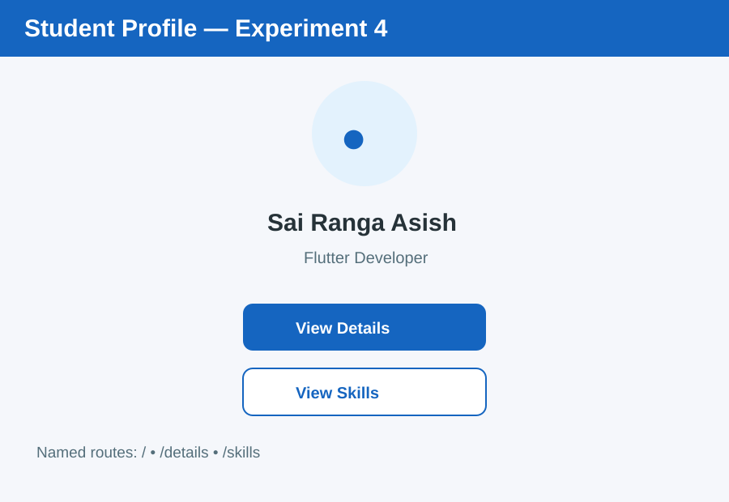
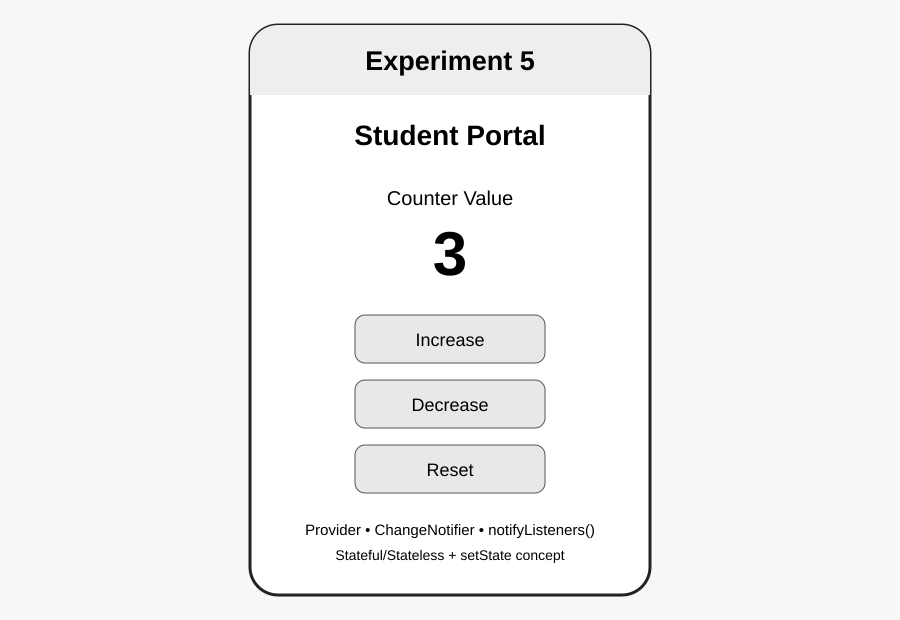
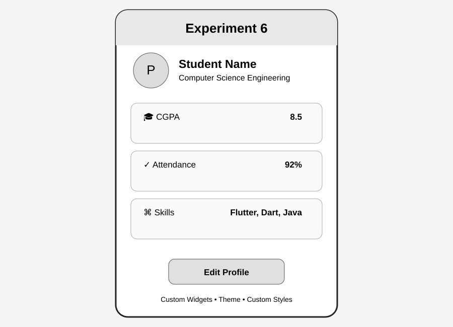

# LogiTrack (Flutter)

## Abstract

LogiTrack is a Flutter-based logistics and delivery management prototype. It demonstrates shipment dashboard design, shipment registration with form validation, navigation, state management, responsive layouts, animations, REST API integration, and widget testing. The project combines the concepts from our Flutter lab experiments into a logistics-themed application.

The app uses Flutter's modern UI framework to deliver a responsive and consistent user experience on both Android and iOS devices from a single codebase. A backend database or cloud service can securely store shipment records and provide real-time synchronization, package tracking, and delivery status updates. Dispatch managers and delivery personnel can access authorized shipment information, verify package registrations, and monitor logistics workflows through role-based access control.

## Experiments 1–10

### Experiment 1 — Dart Basics
Variables, data types, arithmetic operations, delivery charge calculations, string interpolation, and conditional status evaluations applied to logistics metrics.

**Output:**


### Experiment 2 — Flutter Widgets and Layouts
Uses Flutter widgets with **Row**, **Column** and **Stack** to construct a logistics shipment overview card with delivery status indicators and horizontal metric statistics.

**Output:**


### Experiment 3 — Responsive UI
Uses **MediaQuery** and screen width breakpoints (`600px` tablet, `900px` desktop) to adapt the shipment dispatch layout between a multi-column desktop view and a scrollable mobile layout.

**Output:**


### Experiment 4 — Navigation and Named Routes
Uses **Navigator.pushNamed()**, centralized route constants, and clean screen separation (`/`, `/details`, `/fleet`) for multi-screen logistics navigation.

**Output:**



### Experiment 5 — Stateful & Stateless Widgets + State Management
Demonstrates **StatelessWidget**, **StatefulWidget**, **setState()**, and **Provider** using ChangeNotifier and notifyListeners() for dynamic package dispatch counters.

**Output:**



### Experiment 6 — Custom Widgets and Themes
Creates reusable custom widgets for logistics elements (`ShipmentHeader`, `ShipmentInfoCard`, `DispatchButton`) and applies styling through Material 3 **ThemeData**, custom text styles, and card themes.

**Output:**



### Experiment 7 — Forms, Validation and Error Handling
Designs a shipment booking registration form with multiple input fields and implements form validation, field-level error messages, and submission feedback using **Form**, **GlobalKey<FormState>**, **TextFormField**, and **SnackBar**.

**Output:**


### Experiment 8 — Animations
Uses Flutter's animation framework with **AnimationController**, **CurvedAnimation**, **FadeTransition**, and **SlideTransition** to smoothly animate shipment status updates with a replay action.

**Output:**


### Experiment 9 — REST API Integration
Fetches external shipment and consignment records from a public **REST API** using HTTP GET requests. Parses JSON into typed Dart objects and renders records using **FutureBuilder** with loading spinners, error states, and a retry/refresh action.

**Output:**


**Dependency:** Run `flutter pub add http` in a Flutter project before running this experiment.

### Experiment 10 — Testing and Debugging in Flutter
Writes widget tests for reusable shipment UI components and package registration form validation, and demonstrates Flutter debugging tools including Flutter Inspector, DevTools, IDE breakpoints, console logging, and verification commands. Automated UI tests are maintained in `test/exp10_testing_debugging_test.dart`.

**Output:**


**Run the example:** `flutter run -t experiments/10_testing_debugging.dart` (or open the file in your Flutter project and run it as the entry point).

## Experiment Files

```text
experiments/
├── 01_dart_basics.dart
├── 02_widgets_layouts.dart
├── 03_responsive_ui.dart
├── 04_navigation_named_routes.dart
├── 05_setstate_counter.dart
├── 05_state_management.dart
├── 06_custom_widgets_themes.dart
├── 07_forms_validation.dart
├── 08_animations.dart
├── 09_rest_api.dart
├── 10_testing_debugging.dart
└── counter_provider.dart
```

## Automated UI Tests

Run the widget tests with:

```bash
flutter test
flutter analyze
```

The Experiment 10 tests verify the reusable shipment header, shipment registration form validation messages, and navigation to the testing/debugging screen. GitHub Actions runs dependency resolution, static analysis, and widget tests on pushes to `main`, pull requests, and manual workflow dispatches.


## Run LogiTrack as a Website (Flutter Web)

The default app screen is a responsive logistics dashboard with Overview, Fleet & Hubs, Operations, Shipments, Milestones, Contact, and the Experiment 1–10 learning lab.

### Requirements
- Flutter SDK (stable channel)
- Chrome browser
- VS Code or another editor (optional)

### Run locally
From the repository root:

```bash
flutter doctor
flutter pub get
flutter devices
flutter run -d chrome
```

If Chrome is not listed, enable web support and retry:

```bash
flutter config --enable-web
flutter devices
flutter run -d chrome
```

To build a deployable website bundle:

```bash
flutter build web --release
```

The generated website files are placed in `build/web/`. Deploy that folder to a static hosting service.

### Personalise before publishing
- Update the logistics dispatch center details and company info in `LogiTrackDashboard` in `lib/main.dart`.
- Replace the Email, GitHub, and Live Tracking button SnackBar callbacks with your actual contact links.
- Add real consignment demo or repository URLs to the shipment cards.
- Review tracking milestones and only publish details relevant to your distribution network.

### Verify the project

```bash
flutter analyze
flutter test
```
